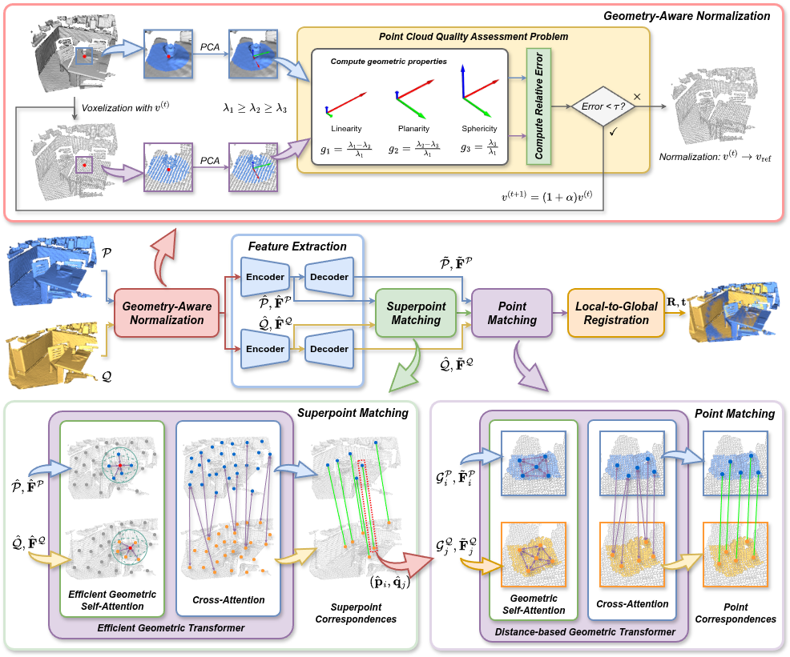

# Register Anything Model for Generalizable and Robust Point Cloud Registration

PyTorch implementation of the paper:

[Register Anything Model for Generalizable and Robust Point Cloud Registration](https://arxiv.org/abs/2610.28821).

[Zheng Qin](https://scholar.google.com/citations?user=DnHBAN0AAAAJ), Junhua Xi, Yan Huang, Jiahong Lai, Anwen Huang, Qiong Li, Guangda Zhang, and [Kai Xu](https://scholar.google.com/citations?user=GuVkg-8AAAAJ).

## Introduction

We present Register Anything Model (RAM), a unified model for generalizable 3D point cloud registration that robustly estimates 6-DoF transformations across diverse domains spanning sensors and environments. Existing registration methods are typically tailored to a single domain, with carefully tuned architectures and hyperparameters, and thus degrade markedly when applied to novel domains. We bridge this gap by training a single model on diverse data from indoor, outdoor, and object domains. A central challenge is the severe geometric discrepancy across domains, i.e., differences in scene scale, sensor noise, point density, and structural patterns, which hinders processing with a unified point-based model. To address this, we introduce a geometry-aware normalization strategy that jointly voxelizes and normalizes point clouds into a standardized geometric space, adaptively based on their geometric properties to preserve salient local structures while standardizing resolution. Built on this normalization, RAM follows a hierarchical coarse-to-fine paradigm, and employs an efficient geometric transformer that models local geometric consistency instead of globally over all points. This design mitigates discretization noise introduced by voxelization, and improves computational efficiency. Extensive experiments on 12 benchmarks demonstrate state-of-the-art performance in terms of inlier ratio and registration recall. Notably, our method outperforms the counterparts trained on each separate domain, showing superior generalization capability.



## News

2026.11.24: Code and pretrained models release.

2026.10.20: Paper is available at [arXiv](https://arxiv.org/abs/2610.28821).

2026.09.26: This work is accepted by NeurIPS 2026.

## Installation

Our code is tested on Python 3.12, PyTorch 2.11, Ubuntu 24.04, and CUDA 12.8.1, but it should work with other configurations. Currently, it only supports training and testing on GPUs.

We recommend using conda to manage the base environment, including G++, CUDA, HDF5, etc.

```bash
conda create -n register_anything python=3.12  # we use python 3.12 because open3d requires python 3.12
conda activate register_anything
conda install numpy scipy hdf5
conda install nvidia::cuda-toolkit==13.2.2
pip install torch torchvision
```

If you encounter any errors related to CUDA when compiling keops, please try the following steps:

```bash
conda env config vars set CUDA_HOME="$CONDA_PREFIX"
conda env config vars set CUDA_PATH="$CONDA_PREFIX/targets/x86_64-linux"  # modify the path according to your platform
```

(Optional) Use `ipdb` as default debugger:
```bash
conda env config vars set PYTHONBREAKPOINT=ipdb.set_trace
```

At last, install Vision3D with the following command:

```bash
pip install -e . --no-build-isolation
```

## Pre-trained Weights

We provide the weights trained on the hybrid dataset (3DMatch, odometryKitti, nuScenes and ModelNet) in the `weights` directory.

## Data preparation

We provide the propressed metadata in `data`, and the data can be prepared as follows.

### 3DMatch

The dataset can be downloaded from [PREDATOR](https://github.com/prs-eth/OverlapPredator). The data should be organized as follows:

```text
--data--3DMatch--metadata
              |--data--train--7-scenes-chess--cloud_bin_0.ply
                    |      |               |--cloud_bin_0.pth
                    |      |               |--...
                    |      |--...
                    |--test--7-scenes-redkitchen--cloud_bin_0.ply
                          |                    |--cloud_bin_0.pth
                          |                    |--...
                          |--...
```

The `.ply` files are the raw point clouds and `.pth` files are the downsampled point clouds.

### Kitti

Download the data from the [Kitti official website](http://www.cvlibs.net/datasets/kitti/eval_odometry.php) and use `data/Kitti/downsample_pcd.py` to generate the downsampled data. The data should be organized as follows:

```text
--data--odometryKitti--metadata
                    |--sequences--00--velodyne--000000.bin
                    |          |             |--...
                    |          |...
                    |--downsampled--00--000000.npy
                                 |   |--...
                                 |--...
```

### nuScenes

Download the data from the [nuScenes official website](https://www.nuscenes.org/) into `data/nuScenes/raw_data` and use `data/nuScenes/prepare_data.py` to prepare the data. The data should be organized as follows:

```text
--data--nuScenes--metadata
               |--raw_data--trainval
               |         |--test
               |--data--trainval--n008-2018-05-21-11-06-59-0400__LIDAR_TOP__1526915243047392.npy
               |     |         |--...
               |     |--test--n008-2018-08-01-15-34-25-0400__LIDAR_TOP__1533152214547215.npy
               |           |--...
               |--downsampled--trainval--n008-2018-05-21-11-06-59-0400__LIDAR_TOP__1526915243047392.npy
                            |         |--...
                            |--test--n008-2018-08-01-15-34-25-0400__LIDAR_TOP__1533152214547215.npy
                                  |--...
```

### ModelNet

Download the [data](https://shapenet.cs.stanford.edu/media/modelnet40_ply_hdf5_2048.zip) and run `data/ModelNet/split_data.py` to generate the data. The data should be organized as follows:

```text
--data--ModelNet--modelnet_ply_hdf5_2048--...
               |--train.pkl
               |--val.pkl
               |--test.pkl
```

### ScanNet++, TIERS, ETH, WOD, MIT, Oxford

Following [BUFFER-X](https://github.com/mit-spark/buffer-x) to download the dataset. The data should be organized as follows:

```text
--data--ScanNet++i--metadata
     |           |--data--07ff1c45bb--cloud_bin_1.ply
     |                 |           |--..
     |                 |--...
     |--TIERS--metadata
     |      |--data--tiers_indoor06--os0_128--000000.pcd
     |            |               |        |--..
     |            |               |--..
     |            |--...
     |--ETH--metadata
     |    |--data--gazebo_summer--Hokuyo_0.ply
     |          |              |--..
     |          |--...
     |--WOD--metadata
     |    |--data--10504764403039842352_460_000_480_000--000000.pcd
     |          |                                     |--..
     |          |--...
     |--MIT--metadata
     |    |--data--acl_jackal--000000.pcd
     |                         |--..
     |--Oxford--metadata
             |--data--01_short_experiments--000000.pcd
                   |                     |--..
                   |--...
```

### ShapeNet

Download the ShapeNetCoreV2 from the [ShapeNet official website](https://huggingface.co/ShapeNet) and run `data/ShapeNet/process_data.py` to prepare the data. The data should be organized as follows:

```test
--data--ShapeNet--metadata
               |--ShapeNetCore.v2
               |--data--02691156--2767994ce3078824f38bce64a8733419.npz
                     |         |--...
                     |--...
```

## Training

The code for RAM is in `experiments/register_anything.stage4.128n.gse.k3.max.oacl.stage2.pde.ds`. Use the following command for training.

```bash
CUDA_VISIBLE_DEVICES=0 python trainval.py
```

After training, use the `tools/compute_averaged_model.py` to generate the average model.

```bash
python compute_averaged_model.py --exp_dir=../output/register_anything.stage4.128n.gse.k3.max.oacl.stage2.pde.ds --start_epoch=31 --end_epoch=60
```

## Testing

Use the following command for testing.

```bash
CUDA_VISIBLE_DEVICES=0 ./eval_all.sh averaged_model.pth
```

To use the pretrained weights:

```bash
CUDA_VISIBLE_DEVICES=0 ./eval_all.sh /path/to/RegisterAnything/weights/register_anything.pth
```

We provide two evaluation scripts for scene-level benchmarks:

1. `eval_3dmatch.py` for the standard evaluation of 3DMatch/3DLoMatch.
2. `eval_scene.py` following the setting of DGR, where RR is computed over all pairs.

```bash
CUDA_VISIBLE_DEVICES=0 python eval_3dmatch.py --benchmark=3DMatch --method=lgr
CUDA_VISIBLE_DEVICES=0 python eval_scene.py --benchmark=odometryKitti --method=lgr
```

## Multi-GPU Training

As the point clouds usually have different sizes, we organize them in the *pack* mode. This causes difficulty for batch training as we need to convert the data between *batch* mode and *pack* mode frequently. For this reason, we limit the batch size to 1 per GPU at this time and support batch training via `DistributedDataParallel`. Use `torch.distributed.launch` for multi-gpu training:

```bash
CUDA_VISIBLE_DEVICES=GPUS python -m torch.distributed.launch --nproc_per_node=NGPUS trainval.py
```

Note that the learning rate is multiplied by the number of GPUs by default as the batch size increased. In our experiments, multi-gpu training slightly improves the performance.

## Results

| Benchmark          |  IR   |  RR   |
| :----------------- | :---: | :---: |
| 3DMatch            | 79.7  | 93.3  |
| 3DLoMatch          | 53.7  | 81.1  |
| ScanNet++ (iPhone) | 70.6  | 90.0  |
| TIERS              | 66.0  | 90.0  |
| odometryKitti      | 90.7  | 99.5  |
| nuScenes           | 70.5  | 97.4  |
| ETH                | 97.5  | 100.0 |
| WOD                | 91.2  | 100.0 |
| MIT                | 74.2  | 100.0 |
| Oxford             | 82.0  | 99.3  |
| ModelNet           | 65.6  | 94.2  |
| ShapeNet           | 65.9  | 79.6  |


## Testing on your own data

We provide a `demo.py` to quickly test our pre-trained model on your own data. Use the following command to run the demo:

```bash
CUDA_VISIBLE_DEVICES=0 python demo.py --src_pcd=/path/to/src.ply --tgt_pcd=/path/to/target.npy --transform=/path/to/gt.txt --checkpoint=/path/to/weights.pth --output_path=/path/to/output_dir --visualize
```

## Citation

```bibtex
@inproceedings{qin2026register,
  title={Register Anything Model for Generalizable and Robust Point Cloud Registration},
  author={Qin, Zheng and Xi, Junhua and Huang, Yan and Lai, Jiahong and Huang, Anwen and Li, Qiong and Zhang, Guangda and Xu, Kai},
  booktitle={Advances in Neural Information Processing Systems},
  year={2026}
}
```